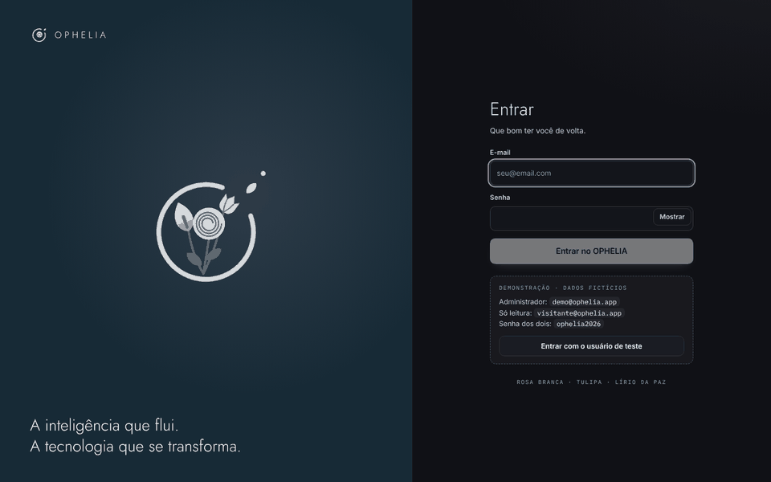
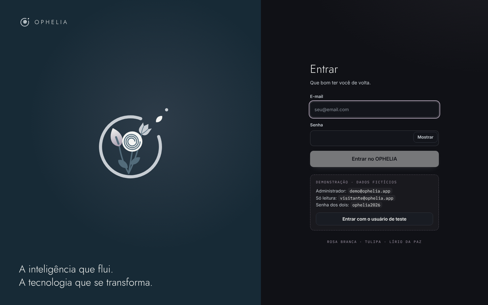
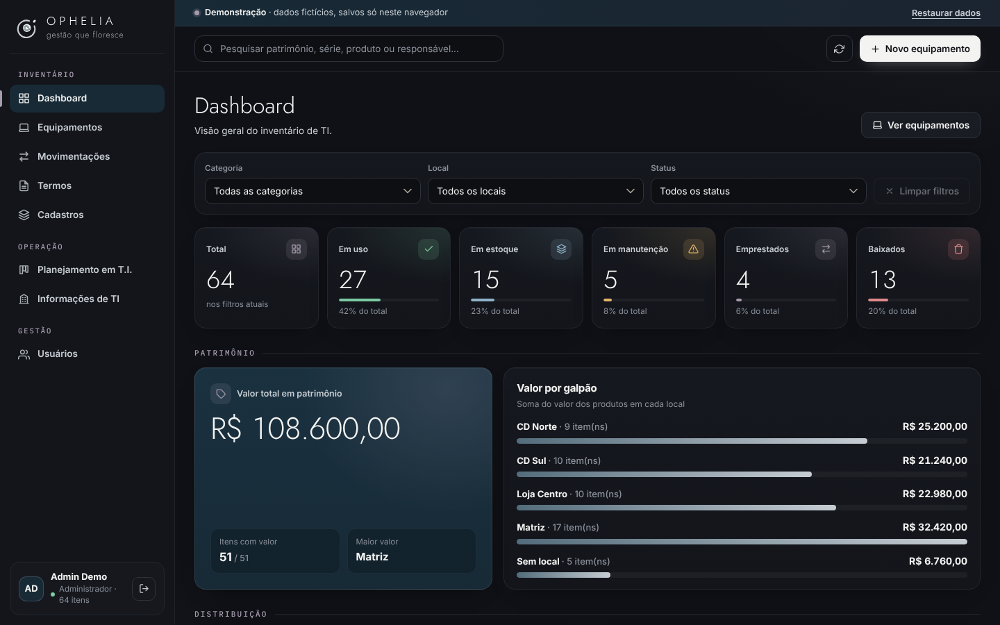
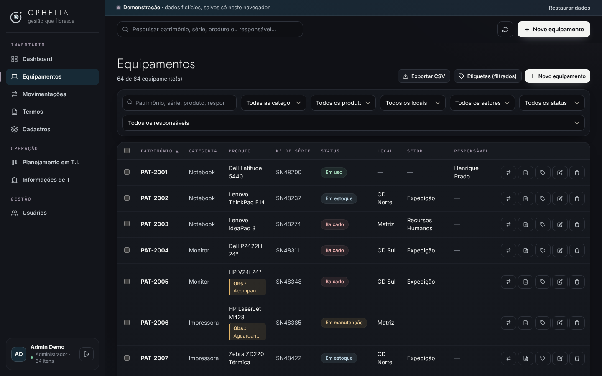
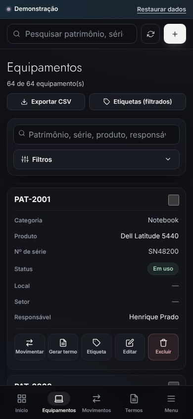
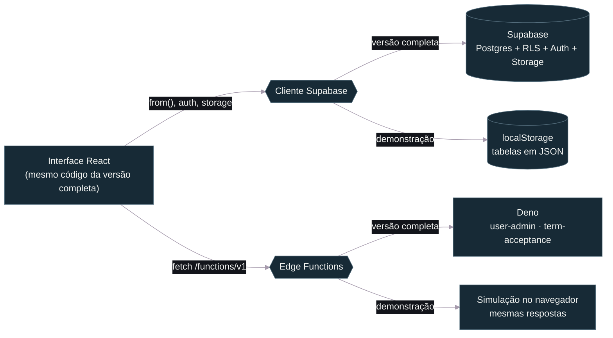
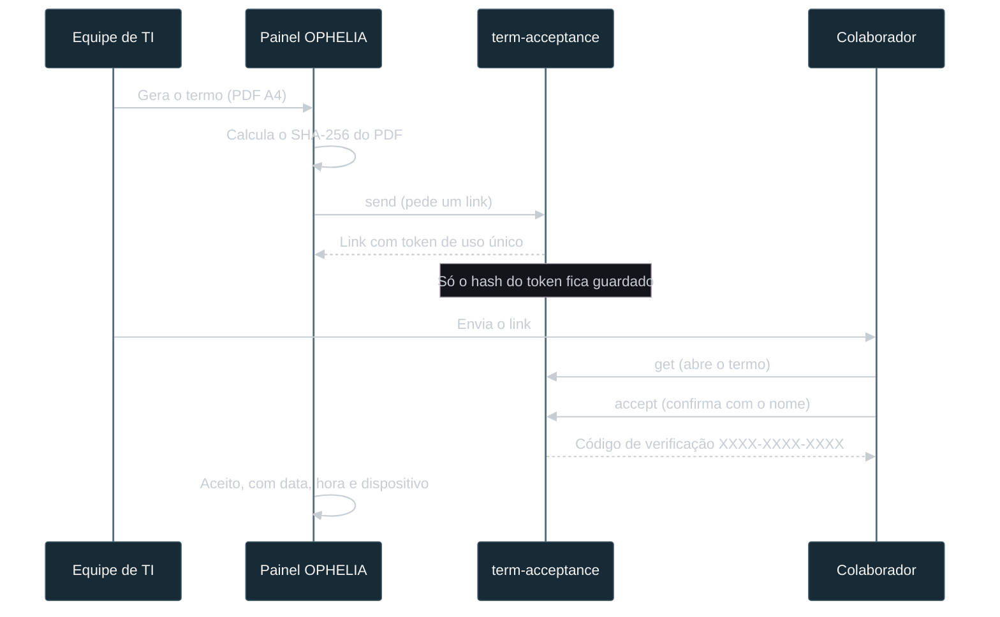
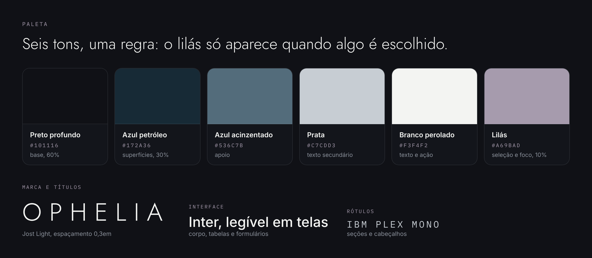

<div align="center">


<br>

<a href="https://callmekaue.github.io/ophelia/"></a>
&nbsp;
<a href="#como-testar"></a>

<br><br>


<br><br>

<i>Rosa branca, tulipa e lírio da paz dentro de um anel aberto: o que chega, o que cresce e o que segue.<br>
Um sistema que cuida dos equipamentos de uma empresa do primeiro cadastro até a devolução.</i>

</div>


## O que é

O **OPHELIA** é um sistema web de **controle de inventário de TI**. Ele responde às perguntas que toda área de TI ouve todo dia:

> *Onde está esse notebook? Com quem? Desde quando? Quanto vale o que temos? Quem assinou o termo?*

Este repositório é a **versão de demonstração**. Ela roda **inteira no navegador**, sem servidor e sem banco de dados, com uma empresa fictícia já cadastrada. Pode cadastrar, movimentar, gerar termos e excluir à vontade: nada sai do seu computador.

<div align="center">

<br><sub>Entrada · Dashboard · Equipamentos · Movimentações · Termos · Planejamento · Informações de TI</sub>
</div>


## Como testar

<table>
<tr>
<td width="58%" valign="top">

**1.** Abra a [demonstração](https://callmekaue.github.io/ophelia/).

**2.** Entre com um dos usuários abaixo ou clique em **"Entrar com o usuário de teste"**.

| Perfil | E-mail | Senha |
|---|---|---|
| Administrador | `demo@ophelia.app` | `ophelia2026` |
| Só leitura | `visitante@ophelia.app` | `ophelia2026` |

**3.** Explore. Sugestão de roteiro de 2 minutos:
- No **Dashboard**, filtre por local e veja o valor do patrimônio mudar.
- Em **Equipamentos**, abra o PAT-2001 e faça uma **movimentação**.
- Em **Termos**, gere um termo de responsabilidade, clique em **gerar link de aceite** e abra o link: assine como se fosse o colaborador e volte ao painel para ver o aceite registrado.
- Entre como **visitante** e repare que os botões de edição somem.

**4.** Para voltar ao início, clique em **"Restaurar dados"** na faixa do topo.

</td>
<td width="42%" valign="top" align="center">

<br><br>

</td>
</tr>
</table>


## Módulos

<table>
<tr>
<td width="33%" valign="top">

**Dashboard**<br>
<sub>Totais por status com a porcentagem de cada um, valor do patrimônio por unidade, gráficos por status, categoria e local, itens por local e últimas movimentações.</sub>

</td>
<td width="33%" valign="top">

**Equipamentos**<br>
<sub>Patrimônio e número de série únicos, produto, local, setor, responsável e observações. Busca, filtros, exportação em CSV e etiquetas com QR code.</sub>

</td>
<td width="33%" valign="top">

**Movimentações**<br>
<sub>Toda transferência ou troca de responsável, setor ou status vira histórico automaticamente, com data e o que mudou.</sub>

</td>
</tr>
<tr>
<td valign="top">

**Termos e aceite digital**<br>
<sub>Termo de responsabilidade e de devolução em PDF A4. Aceite por link individual, com token, validade, hash SHA-256 do documento e código de verificação.</sub>

</td>
<td valign="top">

**Cadastros**<br>
<sub>Locais, setores (todo setor pertence a um local), responsáveis, categorias e produtos com valor patrimonial.</sub>

</td>
<td valign="top">

**Planejamento em TI**<br>
<sub>Quadro de demandas por urgência com arrastar e soltar, mais tarefas mensais com check que reinicia todo mês.</sub>

</td>
</tr>
<tr>
<td valign="top">

**Informações de TI**<br>
<sub>Ficha de cada unidade: dados cadastrais, links de internet, redes Wi-Fi com senhas criptografadas no navegador e dispositivos de rede.</sub>

</td>
<td valign="top">

**Usuários e permissões**<br>
<sub>O administrador define, módulo a módulo, se cada pessoa tem "sem acesso", "só ver" ou "ver e editar".</sub>

</td>
<td valign="top">

**Feito para o celular**<br>
<sub>Navegação inferior, tabelas que viram cartões, filtros recolhíveis e janelas que sobem do rodapé.</sub>

</td>
</tr>
</table>

<div align="center">

&nbsp;

</div>


## Como a demonstração funciona sem servidor

Na versão completa, o OPHELIA usa o **Supabase**: PostgreSQL com regras de acesso por linha (RLS), login, armazenamento dos PDFs e duas Edge Functions. Para a demonstração caber no GitHub Pages, um script de cerca de 200 linhas no começo do `index.html` (procure por `OPHELIA — MODO DEMONSTRAÇÃO`) **imita a mesma interface do cliente do Supabase**. Assim, o resto do sistema roda sem nenhuma mudança.



| Peça da versão completa | Na demonstração |
|---|---|
| Banco PostgreSQL com RLS | Tabelas em JSON no `localStorage` |
| Supabase Auth | Usuários de teste conferidos no próprio navegador |
| Storage dos PDFs | Arquivos guardados como *data URL* |
| Edge Function `user-admin` | Criar usuário, trocar senha e excluir, simulados |
| Edge Function `term-acceptance` | Token, SHA-256 e código de verificação, simulados |

### O caminho de um aceite digital




## Identidade visual

<div align="center">

</div>

<table>
<tr>
<td width="120" align="center"></td>
<td>

**O símbolo** é um anel aberto com três flores: a **rosa branca**, vista de cima e em espiral, no centro; a **tulipa** subindo pela abertura do anel; e o **lírio da paz**, em degradê, à esquerda. Uma pétala escapa pela abertura: o anel não fecha, a gestão continua.

A interface segue a regra 60-30-10: **preto profundo** de base, **azul petróleo** nas superfícies e no item ativo, e **lilás** reservado para seleção e foco. O botão principal é **branco perolado**: a ação mais importante da tela é sempre a mais clara.

</td>
</tr>
</table>


## Estrutura do repositório

```
ophelia/
├── index.html                  # o sistema inteiro: interface, regras e a simulação do Supabase
├── README.md
├── ophelia-readme-arquivos/    # imagens, GIF e símbolo deste README
└── supabase/                   # referência da versão completa
    ├── schema.sql              # tabelas, restrições, RLS e storage
    ├── user-admin.ts           # Edge Function de usuários
    └── functions/term-acceptance/index.ts
```

## Rodar no seu computador

Não há instalação nem build. Baixe o repositório e abra o `index.html` num servidor local qualquer, por exemplo:

```bash
npx serve .
# ou
python -m http.server 8080
```

Abrir com dois cliques também funciona para navegar. Só o link de aceite digital precisa de `http://` ou `https://`.

## Publicar no GitHub Pages

1. Envie os arquivos para um repositório, com o `index.html` na raiz.
2. Vá em **Settings → Pages**, escolha **Deploy from a branch**, a branch `main` e a pasta `/ (root)`.
3. Em alguns minutos o endereço aparece no topo da página.


<div align="center">


**OPHELIA** · gestão que floresce

Desenvolvido por **[Cicero Kauê Alves da Silva](https://github.com/callmekaue)**<br>
<sub>Engenharia de Software · UNICID</sub>

<sub>Todos os dados da demonstração são fictícios. Nomes, empresas, e-mails e endereços foram inventados.</sub>

</div>
